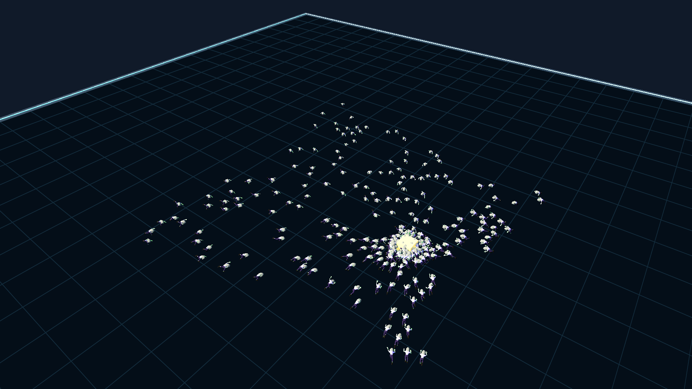
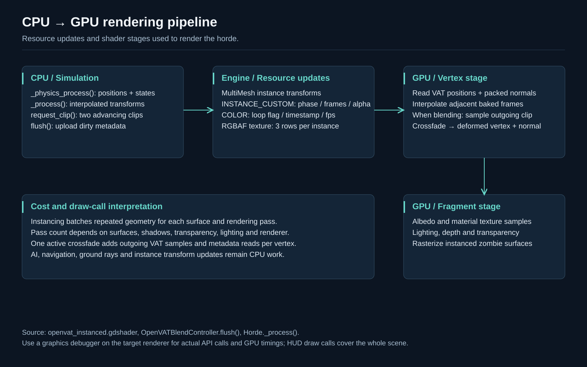

# Horde System · Godot 4.6

A standalone demonstration of Zmail's horde architecture: array-based enemy simulation, budgeted navigation, spatial queries, stable agent IDs, and GPU vertex animation through MultiMesh.



## Run

Open `project.godot` with Godot **4.6.1 or newer 4.6.x**, let asset import finish, then press **F6** on `showcase/main.tscn` or **F5**. No plugins need enabling, no terrain extension is required, and no parent-project files are loaded. Desktop Compatibility rendering is the tested configuration.

```sh
godot --editor --path .
godot --path .
```

The runnable populations are **64 / 256 / 1,024**. These are selectable workloads, not performance guarantees. Click the arena to move the amber target; agents navigate and attack it.

| Control | Action |
|---|---|
| 1 / 2 / 3 | Reset with 64 / 256 / 1,024 agents |
| Click | Move target on the flat arena |
| Space / R | Pause / reset current population |
| K | Lethal radius pulse at the target; death clips finish before removal |
| B | Abduct brain; staggered deaths demonstrate lifecycle handling |
| G / Tab | Toggle reference grid / panel |
| Left / Right / wheel | Orbit / zoom |
| F12 | Write PNG to `media/` |

## Engineering focus

- **Simulation ownership:** one Horde node maintains packed position, health and timing arrays plus state/path arrays. Zombies do not each require a scene node, skeleton or AnimationPlayer.
- **Shared intent, individual state:** the brain supplies horde behavior while each agent handles movement, effects, attacks and terminal death animation.
- **Navigation scheduling:** stable-ID requests are consumed under a per-tick budget. This arena uses 16 queued requests per tick; the source default is 4. Brain navigation is separate from that budget.
- **Spatial locality:** 5 m cells narrow neighbor and combat queries. Avoidance limits accepted neighbors, while dense-cell candidate enumeration can still be expensive.
- **Animation:** state changes select baked clips. The blend controller retains an advancing outgoing clip, uploads three RGBAF metadata rows per instance, and lets the vertex shader crossfade positions and normals.
- **Compaction:** `die()` moves the last live agent into the removed slot, copies related simulation and animation state, and decreases visible instance count without reallocating the MultiMesh. Stable IDs keep deferred requests valid.



## Scope and provenance

The horde, geometry, effect settings, attack-area contract, VAT controller and runtime shader are source snapshots from the parent project. `showcase/` is a new presentation harness and minimal player adapter. The enemy scene is rebuilt without its large embedded mesh; the actual zombie GLB and VAT bake are loaded at runtime. There is no terrain, vehicle simulation, full game loop or dependency on the parent autoloads other than the copied effect settings.

The flat navigation surface isolates behavior rather than demonstrating obstacle routing. The grid is a world reference aligned to the spatial cell size; it does not visualize occupied-cell membership. The renderer still handles several passes: MultiMesh batching does **not** imply one draw call for the scene. See [architecture](docs/architecture.md), [verification](docs/verification.md), and [credits](CREDITS.md).

## Showcase kit

| File | Use |
|---|---|
| `media/04-hero.png` | Clean website or GitHub cover; real engine capture |
| `media/01-overview.png` | Whole horde with runtime metrics |
| `media/02-close-view.png` | Closer animation and target view |
| `media/03-spatial-grid.png` | Elevated arena and spatial cell scale |
| `media/workflow.svg` | Simulation workflow graphic |
| `media/gpu-pipeline.svg` | CPU/resource upload/vertex/fragment diagram |
| `media/spatial-and-lifecycle.svg` | Spatial lookup and stable-ID compaction |
| `docs/portfolio-copy.md` | Website copy, captions, alt text and walkthrough |
| `docs/architecture.md` | Source map, tradeoffs and editable Mermaid flowcharts |
| `docs/source-manifest.json` | Checksums and exact snapshot provenance |

All screenshots are 1600 × 900 PNGs. Diagrams are available as 1600 × 1000 PNGs and scalable SVGs with text and accessible titles. Regenerate the diagrams with `python3 tools/build_diagrams.py`.

```sh
# Write four actual viewport PNGs, then exit.
godot --path . -- --capture
# Integration checks, including all three populations.
godot --path . res://tests/smoke.tscn
# GPU-rendered VAT correctness checks; requires desktop graphics.
godot --path . res://tests/open_vat_blend_test.tscn
```

Capture transitions are scheduled by physics ticks with a fixed random seed. Rendering rate and asynchronous engine work can still change exact pixels. The HUD reports whole-scene draw calls and process time, not horde-only draws or GPU time. `media/capture-observation.json` records one capture-run observation, not a benchmark.

To make a separate GitHub repository, copy **the contents of this folder** as its root. `.godot/` is ignored. Review [credits and redistribution scope](CREDITS.md) before choosing a public repository license.
