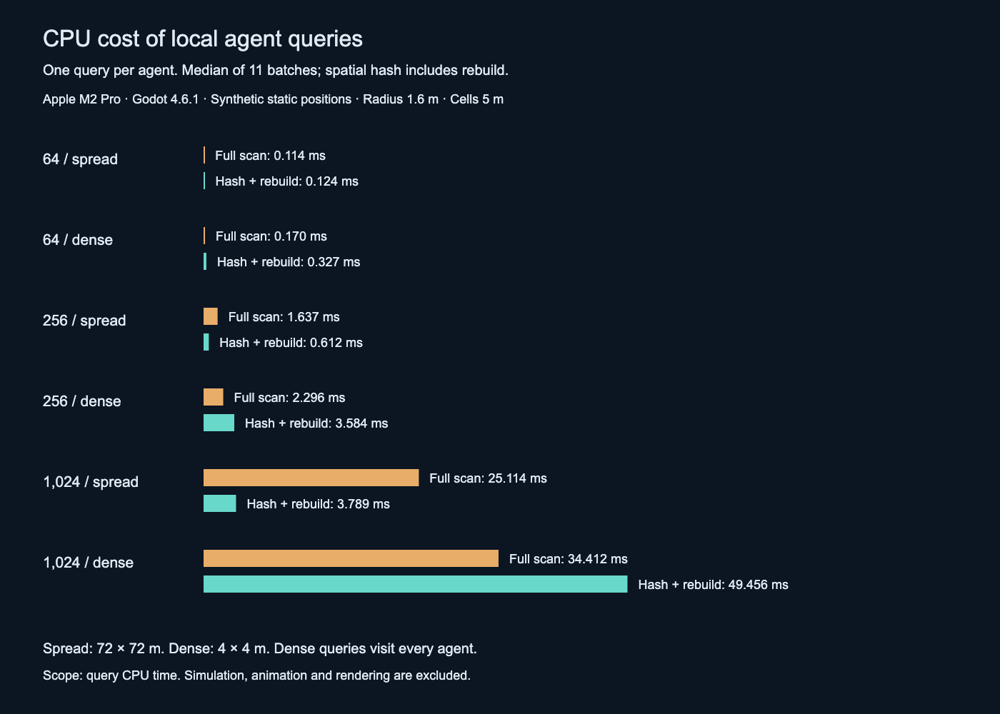

# Horde System · Godot 4.6

A standalone demonstration of Zmail's horde architecture: array-based enemy simulation, budgeted navigation, spatial queries, stable agent IDs, and GPU vertex animation through MultiMesh.


## Run

Clone or download this repository:

```sh
git clone https://github.com/GarrettMcNeill2/horde-system-showcase.git
cd horde-system-showcase
```

Open `project.godot` with Godot **4.6.1 or newer 4.6.x**, let asset import finish, then press **F6** on `showcase/main.tscn` or **F5**. Desktop Compatibility rendering is the tested configuration.

```sh
godot --editor --path .
godot --path .
```

The runnable populations are **64 / 256 / 1,024**. Click the arena to move the amber target; agents navigate and attack it.

| Control | Action |
|---|---|
| 1 / 2 / 3 | Reset with 64 / 256 / 1,024 agents |
| Click | Move target on the flat arena |
| Space / R | Pause / reset current population |
| K | Lethal radius pulse at the target; death clips finish before removal |
| B | Abduct brain; staggered deaths demonstrate lifecycle handling |
| G / Tab | Toggle reference grid / panel |
| Left / Right / wheel | Orbit / zoom |
| F12 | Write PNG to `media/` |

## Resource savings

At 1,024 agents spread over a 72 × 72 m area, the spatial-query benchmark reduced CPU time from **25.114 ms to 3.789 ms per batch**, including grid rebuild. That is **84.9% less time** for one radius query per agent on an Apple M2 Pro. Both implementations returned identical results. Full scans were faster in all dense cases and at 64 spread-out agents.

The system also batches zombie rendering, evaluates baked animation on the GPU, budgets queued path requests and reuses instance allocations during deaths. See [resource savings and profiling metrics](docs/performance.md) for measured results, comparison assumptions, GPU tradeoffs and reproduction commands.



## Engineering focus

- **Simulation ownership:** one Horde node maintains packed position, health and timing arrays plus state/path arrays. Zombies do not each require a scene node, skeleton or AnimationPlayer.
- **Shared intent, individual state:** the brain supplies horde behavior while each agent handles movement, effects, attacks and terminal death animation.
- **Navigation scheduling:** stable-ID requests are consumed under a per-tick budget. This arena uses 16 queued requests per tick; the source default is 4. Brain navigation is separate from that budget.
- **Spatial locality:** 5 m cells narrow neighbor and combat queries. Avoidance limits accepted neighbors, while dense-cell candidate enumeration can still be expensive.
- **Animation:** state changes select baked clips. The blend controller retains an advancing outgoing clip, uploads three RGBAF metadata rows per instance, and lets the vertex shader crossfade positions and normals.
- **Compaction:** `die()` moves the last live agent into the removed slot, copies related simulation and animation state, and decreases visible instance count without reallocating the MultiMesh. Stable IDs keep deferred requests valid.


## Project layout

`showcase/` contains the arena, camera, controls and target. `scripts/enemies/` contains the horde simulation and hit geometry. `addons/openvat_animated/` contains the animation runtime and shader. Zombie models and animation textures load from `art/anims/zom/`.

The demo uses a flat navigation surface and a 5 m reference grid. See [implementation details](docs/architecture.md), [test results](docs/verification.md), and [credits](CREDITS.md).

## Screenshots and diagrams

| File | Use |
|---|---|
| `media/04-hero.png` | Arena view with the panel hidden |
| `media/01-overview.png` | Whole horde with runtime metrics |
| `media/02-close-view.png` | Closer animation and target view |
| `media/03-spatial-grid.png` | Elevated arena and spatial cell scale |
| `media/workflow.svg` | Simulation workflow graphic |
| `media/gpu-pipeline.svg` | CPU/resource upload/vertex/fragment diagram |
| `media/spatial-and-lifecycle.svg` | Spatial lookup and stable-ID compaction |
| `docs/walkthrough.md` | Things to try in the demo |
| `docs/architecture.md` | Simulation and rendering details |
| `docs/source-manifest.json` | Checksums and exact snapshot provenance |

All screenshots are 1600 × 900 PNGs. Diagrams are available as 1600 × 1000 PNGs and scalable SVGs with text and accessible titles. Regenerate the diagrams with `python3 tools/build_diagrams.py`.

```sh
# Write four actual viewport PNGs, then exit.
godot --path . -- --capture
# Integration checks, including all three populations.
godot --path . res://tests/smoke.tscn
# GPU-rendered VAT correctness checks; requires desktop graphics.
godot --path . res://tests/open_vat_blend_test.tscn
```

Capture transitions are scheduled by physics ticks with a fixed random seed. Rendering rate and asynchronous engine work can still change exact pixels. The HUD reports whole-scene draw calls and process time. `media/capture-observation.json` records a single capture run. Frame metrics can vary while screenshots are being saved.

