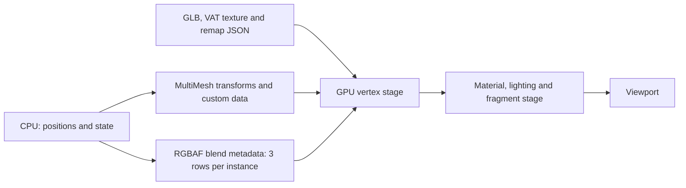
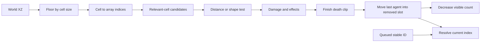

# Implementation notes

## Entry points and ownership

`showcase/main.tscn` loads `showcase/showcase.gd`. `_build_arena()` creates a flat collision body, an explicit navigation polygon, a target, camera and lighting. `_spawn()` instantiates the rebuilt horde scene with a fixed seed, selected population and a queued-path budget of 16 per tick. The source Horde script is unchanged.

`showcase/player.gd` implements only the contract the horde consumes: a `CharacterBody3D` RID for ray exclusions, `van()` for discovery, a target hook point and damage accumulation. There is no vehicle behavior. Effect settings are the sole autoload. The source attack-area script remains available for shape combat; the harness's K key demonstrates the direct radius-damage path instead.

## Physics → render data flow

`Horde._physics_process()` updates brain intent, gravity, effects, individual states and movement. It stores current transforms, drains queued path requests, rebuilds the spatial hash and scans active attack areas. `_process()` advances the pause-aware animation clock, flushes blend metadata and interpolates previous/current world transforms before converting them to the moving MultiMesh's local space. Only transforms interpolate; clip frame indices remain discrete.

`sync_animation_track()` maps states to VAT clips and chooses transition durations, one-shot behavior and attack playback rates. `OpenVATBlendController.request_clip()` records both clips' metadata; `flush()` updates the material clock and dirty texture. The shader samples adjacent frames for position and normals, optionally samples an advancing outgoing clip, then blends the decoded deformation. Animation deformation runs in the vertex shader; AI runs on the CPU.

```mermaid
flowchart LR
    Brain[Brain state] --> Agents[Gravity, effects, agent state and motion]
    Agents --> Paths[Consume stable-ID path requests]
    Paths --> Hash[Rebuild spatial cells]
    Hash --> Combat[Broad phase and narrow phase combat]
    Combat --> Clips[State to VAT clip metadata]
    Clips --> Render[Interpolate transforms and flush metadata]
    Render --> GPU[MultiMesh and VAT vertex shader]
```

## Cost model and limits

- Simulation, hash rebuilding and render transform updates iterate across the live population. Ground snapping performs physics rays. Navigation and AI remain CPU work.
- The queued individual path budget controls queue consumption. Brain navigation calls run separately. `resolve_zombie()` linearly searches stable IDs; queue de-duplication and removing from its front also have scaling costs.
- Cell queries reduce expected candidates for spread-out crowds. Avoidance caps accepted neighbors at eight, but building the candidate list can still traverse many agents in dense cells. Dense crowds can increase query costs substantially.
- Swap removal copies the final live slot across related arrays and animation data, avoids shifting survivors, and retains the GPU allocation. Memory is released when the horde is reset or destroyed.
- Metadata storage is 3 × 16 bytes = 48 bytes per allocated agent before engine/texture overhead. `ImageTexture.update()` uploads the complete metadata image when dirty.
- Each ordinary VAT sample uses adjacent-frame position and normal reads. Crossfades add outgoing-clip reads plus metadata texture reads. Fragment material samples, transparent passes and shadows add separate cost.
- MultiMesh batches repeated geometry by surface and rendering pass. The HUD is whole-scene draw count. GPU timestamp profiling remains untested.
- The world grid uses one antialiased shader plane. It illustrates cell size. The arena script owns the camera and UI.
- The arena has no obstacles and no terrain variation; those production cases are deliberately outside the isolated demo. Culling uses broad horde bounds, trading fine-grained culling for simpler batching.

## Relevant source

| Source | Responsible functions |
|---|---|
| `scripts/enemies/horde.gd` | `_physics_process`, `_process`, `process_path_requests`, `compute_avoidance`, `query_radius`, `query_aabb`, `die`, `resolve_zombie`, `sync_animation_track` |
| `scripts/enemies/horde_hit_geometry.gd` | Exact shape overlap helpers |
| `scripts/player/player_attack_area.gd` | Per-horde stable-ID hit bookkeeping |
| `addons/openvat_animated/src/open_vat_blend_controller.gd` | Clip requests, moving source clip, metadata upload and compaction |
| `addons/openvat_animated/shaders/openvat_instanced.gdshader` | VAT sampling, frame interpolation, clip blending, material rendering |
| `showcase/showcase.gd` | Isolated arena, controls, population presets, statistics and captures |
