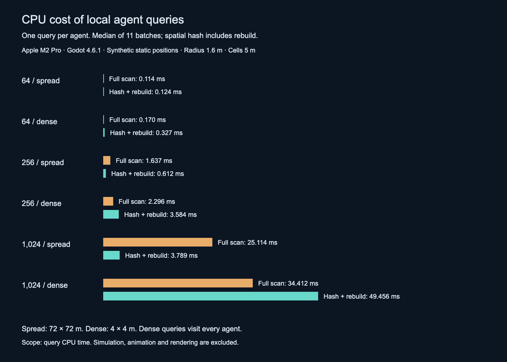

# Resource savings

The horde reduces repeated CPU work through spatial queries, shared instance rendering, animation textures and a path-request budget. This page gives measured query results, source-derived resource counts and the profiling metrics needed to evaluate the full game.

## Measured CPU savings

The benchmark calls the production `Horde.query_radius()` once per agent and compares its results with a full distance scan over the same positions. Hash timing includes rebuilding the grid. Every query returned the same set of agents in both implementations.



| Agents | Layout | Full scan (ms) | Hash + rebuild (ms) | Time reduction | Distance-test reduction |
|---:|---|---:|---:|---:|---:|
| 64 | spread | 0.114 | 0.124 | -8.8% | 94.5% |
| 64 | dense | 0.170 | 0.327 | -92.4% | 0.0% |
| 256 | spread | 1.637 | 0.612 | 62.6% | 95.7% |
| 256 | dense | 2.296 | 3.584 | -56.1% | 0.0% |
| 1,024 | spread | 25.114 | 3.789 | 84.9% | 96.0% |
| 1,024 | dense | 34.412 | 49.456 | -43.7% | 0.0% |

At 1,024 spread-out agents, local queries and one grid rebuild took **3.789 ms**, compared with **25.114 ms** for full scans. That saves **21.325 ms per query batch**, a **84.9% reduction** in this CPU workload. Distance tests fell from **1,048,576 to 41,870**, a **96.0% reduction**.

The dense layout puts all agents in a 4 × 4 m area. Every query visits every agent, eliminating candidate pruning. Full scans are faster in all dense cases and at 64 spread-out agents because hashing adds overhead. These results show why crowd distribution matters. The full-scan baseline caches the positions array and squared radius outside its inner loop.

Method: Apple M2 Pro, macOS, Godot 4.6.1, headless debug runtime; fixed seed 73421; 5 m cells; 1.6 m query radius; three warm-up batches; eleven measured batches per implementation with alternating execution order. Spread positions cover 72 × 72 m. Positions remain fixed during measurement. The benchmark isolates radius-query CPU work; game simulation, rendering, neighbor caps and animation are outside the timed region. A complete frame includes those additional costs. Results come from one machine and one process run. Raw samples are in [spatial-results.json](../benchmarks/spatial-results.json).

## Where the other savings come from

| Area | Work reduced by this implementation | Quantifiable scope | Tradeoff |
|---|---|---|---|
| Render submission | A MultiMesh groups repeated zombie geometry into instanced draws | For an illustrative unbatched, one-surface, one-pass baseline: 1,024 submissions become one instanced submission, or 99.90% fewer submissions for that pass | Renderer batching, shadows and material passes affect actual counts. Vertex and pixel work still scales with visible geometry |
| CPU animation | The VAT shader reconstructs baked poses; each zombie uses clip metadata | The horde creates zero per-zombie Skeleton3D or AnimationPlayer nodes. Blend metadata is 48 bytes per allocated agent, totaling 48 KiB for 1,024 agents | Shared VAT textures consume GPU memory; frame interpolation and crossfades add vertex texture reads |
| Navigation spikes | The queue consumes at most 16 individual requests per physics tick | If 1,024 agents request paths together, the first tick consumes at most 16: a 98.44% reduction in that burst. A static queue takes at least 64 ticks, about 1.07 s at 60 Hz | Requests wait longer. Brain queries run separately. Total eventual path work may remain similar |
| Scene management | Agent state lives in arrays owned by a horde | Each additional agent adds zero scene nodes to the horde hierarchy | Array storage, state updates and transform uploads still grow with population |
| Local combat and avoidance | Cell lookups narrow the candidates passed to exact tests | The query benchmark above measures the radius path; shape attacks use the related AABB broad phase | Dense cells increase candidates; the eight-neighbor cap limits accepted avoidance contributions |
| Death and respawn | Swap removal copies the last live slot into the removed slot and reduces visible count | Removing slot zero from a 1,024-entry ordered array could shift 1,023 survivors; this implementation moves one survivor across its state arrays | Stable-ID lookup still scans IDs. Allocated MultiMesh capacity stays until reset or destruction |

The percentages in this table are calculations from explicit comparison scenarios and the code's settings. They describe submission or request counts. CPU/GPU millisecond savings for those scenarios require paired measurements. Godot documents MultiMesh instancing, visibility limits and capacity reuse in [Optimization using MultiMeshes](https://docs.godotengine.org/en/4.6/tutorials/performance/using_multimesh.html). Its [vertex-animation example](https://docs.godotengine.org/en/4.6/tutorials/performance/vertex_animation/animating_thousands_of_fish.html) explains how shader animation avoids per-object CPU bone evaluation.

## Metrics used to profile enemy management

Frame-time budgets follow `1000 / target FPS`: **33.33 ms at 30 FPS**, **16.67 ms at 60 FPS**, and **8.33 ms at 120 FPS**. These budgets cover the entire frame. Enemy-system budgets depend on the game, hardware, scene and other systems sharing the frame. The sources below establish profiling measures; they provide no universal CPU or GPU percentage for enemies.

| Metric | What to record | How the horde can help |
|---|---|---|
| CPU AI and state updates | Milliseconds per physics tick, median and p95 across a fixed scenario | Shared data ownership removes per-agent node callbacks; per-agent logic remains |
| CPU path queries | Query count, total query time, maximum time per tick, queue length and wait time | Budgeting spreads bursts across ticks |
| CPU local interactions | Candidate tests, accepted neighbors, rebuild time and query time | Spatial hashing reduces tests in spread-out crowds |
| CPU animation evaluation | Milliseconds spent evaluating poses and animation graphs | Baked poses and GPU deformation remove the per-agent skeleton evaluation path |
| CPU render submission | Draw calls by pass and render-thread time | Instancing reduces repeated draw setup |
| GPU rendering | GPU frame time, vertex/fragment pass time, triangles, texture bandwidth and overdraw | Shared draws reduce submission overhead; VAT changes the animation workload. GPU-time benefit remains workload-dependent |
| Memory | CPU allocations, node counts, instance buffers and resident mesh/texture bytes | Shared resources and compact metadata avoid repeated object state. VAT adds a shared texture cost |
| Frame stability | Median, p95 and p99 frame times under a reproducible workload | Bounded requests and allocation reuse can reduce spikes |

Godot exposes frame, physics, navigation, draw-call, object and memory monitors through [Performance](https://docs.godotengine.org/en/4.6/classes/class_performance.html). Some counters refresh at intervals and some require debug builds. Its navigation monitor includes map updates and server avoidance; instrument `map_get_path()` call sites to measure this horde's direct path searches. Godot's [navigation optimization guide](https://docs.godotengine.org/en/4.6/tutorials/navigation/navigation_optimizing_performance.html) discusses query frequency and path-search complexity.

## GPU scope

The current repository has whole-scene draw-call observations and CPU query timings. GPU timestamp measurements and an equivalent skeletal-animation baseline remain outstanding. A GPU-bound scene can retain similar frame time after CPU work is reduced. Broad MultiMesh bounds also keep offscreen instances in a visible batch, and VAT crossfades increase texture sampling. Profile the target renderer before assigning a GPU savings percentage.

## Reproduce the query benchmark

```sh
godot --headless --editor --path . --import --quit
godot --headless --path . res://benchmarks/spatial_queries.tscn
python3 tools/build_performance_report.py
```

The benchmark overwrites its JSON results. The Python script regenerates the results table and SVG chart. The published PNG and prose summarize the checked-in run; refresh them when publishing new measurements.

Sources inspected on November 1, 2026. Documentation links target Godot 4.6. The MultiMesh and vertex-animation tutorials carry version-update notices; their mechanisms are also visible in this repository's implementation. These sources support the mechanism descriptions. The timing results come from the included benchmark.
